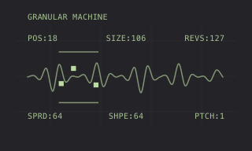

# FRACT — granular machine artwork



Original conceptual artwork for FRACT's Modwerk track-machine interface,
approved by ex1010. This is an illustration, not a device screenshot or a
measurement. The displayed values are illustrative.

- [Editable SVG](thumbnail.svg): 320 × 192 viewBox.
- [Card PNG](thumbnail.png): 320 × 192.
- [Large PNG](thumbnail@3x.png): 960 × 576.

The header aligns with POS on the left. POS / SIZE / REVS appear above the
continuous waveform; SPRD / SHPE / PTCH appear below. Three filled grain
markers and two horizontal range bars share a soft lime accent (`#bbdba2`)
on the dark Modwerk surface (`#232328`).

The SVG is the source of truth. Re-export the PNGs after editing it:

```sh
rsvg-convert -w 320 -h 192 thumbnail.svg -o thumbnail.png
rsvg-convert -w 960 -h 576 thumbnail.svg -o thumbnail@3x.png
```

The artwork is ready to use as `presentation/thumbnail.svg` when the current
track machine is integrated into Modwerk. Publishing these files does not
publish or qualify the machine package, or replace the earlier FX2/SPACE
implementation in [draft PR #926](https://github.com/repeat98/modwerk/pull/926).

Copyright © 2026 ex1010. These original SVG and PNG files are available under
the [MIT licence](LICENSE.md), for reuse and modification with its notice.
They contain no firmware, stock screen captures, recordings or samples.
